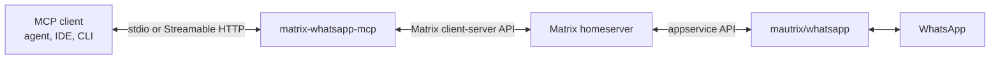

<p align="center">
  
</p>

# matrix-whatsapp-mcp

A single Go binary that keeps a Matrix `/sync` listener on a mautrix/whatsapp bridge and exposes the conversation to a Model Context Protocol client through nine tools, over stdio or Streamable HTTP.

[](LICENSE)
[](go.mod)
[](https://modelcontextprotocol.io)
[](https://github.com/ButterHost69/matrix-whatsapp-mcp/actions/workflows/ci.yml)

## What it does

The binary logs into a Matrix homeserver as an ordinary account, syncs the chats the bridge relays, and answers MCP tool calls about them: list chats, read a page of history, search it, read the messages around one message, list a chat's contacts, fetch an attachment, replay the incoming messages it has seen, and send a reply or a photo. Sending is disabled by default and fails closed: only chats on an allowlist can receive a message. It also listens for chat invitations and can join them on its own, so a newly relayed chat becomes usable without opening Element.



## Terminology

The tools speak WhatsApp, because the agent calling them is doing WhatsApp work. The IDs
underneath are still Matrix IDs, handed out by the bridge.

| Word | Meaning |
| --- | --- |
| `chat`, `chat_id` | One WhatsApp conversation. The ID is a Matrix room ID such as `!abc:example.com`; the bridge sometimes omits the `:server` part, which is valid. |
| `message`, `message_id` | One WhatsApp message. The ID is a Matrix event ID such as `$abc123`. |
| `contact` | A participant in a chat: a WhatsApp contact or group, the bridge bot, or a plain Matrix account. |
| `type` | `text`, `image`, `video`, `audio`, `document`, `sticker`, `location`, or `other`. |
| `whatsapp` | Whether the chat or contact belongs to WhatsApp rather than being a plain Matrix room or account. |
| `media_uri` | An opaque reference to an attachment's stored bytes. |

Renamed from the Matrix-era surface:

| Old | New |
| --- | --- |
| `list_rooms`, `read_messages`, `list_participants`, `get_recent_triggers` | `list_chats`, `get_messages`, `list_chat_contacts`, `get_new_messages` |
| `room_id`, `event_id`, `since_timestamp` | `chat_id`, `message_id`, `since` |
| `room_name`, `sender`, `body`, `msgtype`, `redacted`, `mxc_uri`, `bridged`, `bridge_kind` | `chat_name`, `from`, `text`, `type`, `deleted`, `media_uri`, `whatsapp`, `contact_type` |
| `scanned_rooms`, `scanned_events`, `participants` | `scanned_chats`, `scanned_messages`, `contacts` |

The old **input** names are still accepted, as deprecated aliases documented in each tool's
schema, so a model that guesses `room_id` still works. The old **output** names are gone: no
result carries `room_id`, `event_id`, `body` or `msgtype` any more. Configuration keeps its
Matrix vocabulary (`MATRIX_*`, `ALLOWED_SEND_ROOMS`), and `rooms` remains a hidden CLI alias
of `chats`.

## Features

**Read**

- `list_chats` — every joined chat, its display name, and a best-effort flag for whether it is a WhatsApp chat relayed by the bridge.
- `get_messages` — one page of a chat's history, oldest first, behind an opaque `next_token`. Each message carries `reply_to`, `edit_of`, `mentions` and `deleted`, so a client reads a conversation instead of isolated messages, plus `mimetype`, `filename`, `size_bytes`, `width`, `height`, `duration_ms` and `media_uri` when it has an attachment.
- `search_messages` — the homeserver's own search index first; when it has none, a bounded scan of the 50 newest messages in at most 10 chats, with `truncated`, `scanned_chats`, `scanned_messages` and `source` reporting what actually happened.
- `get_message_context` — one message with up to 50 messages on each side, and `reply_to`/`edit_of` resolved to full messages.
- `list_chat_contacts` — joined contacts with `whatsapp` and `contact_type` (`whatsapp_contact`, `bridge_bot`, or `matrix_user`).
- `get_media` — one message's attachment, returned as a text block with its metadata (mimetype, filename, size, dimensions, whether it was downscaled, media URI) plus an `image` or `audio` content block when the payload fits about 1.5 MiB of base64. Images are downscaled to `max_dimension` (default 1568) and re-encoded; a 25 MiB download cap applies, and nothing is cached or written to disk.
- `get_new_messages` — the newest 100 incoming messages the process has seen, newest first, each with `chat_id`, `chat_name`, `message_id`, `from`, `text`, `type` and `timestamp`.

**Write**

- `send_message` — plain text, optionally as a reply (`reply_to`) and optionally idempotent (`idempotency_key`, 10-minute window).
- `send_media` — an image, video, voice note or file from an absolute path or base64 data, with a caption that WhatsApp shows under it, the same `reply_to` and `idempotency_key` handling, and a 50 MiB upload cap.
- Fail-closed allowlist: an empty allowlist makes the server read-only, and a chat missing from a non-empty one is rejected.
- One message per 3 seconds across all chats, shared by both sending tools, with the retry delay in the error.
- Bridge-ack guard: a message the WhatsApp bridge refuses is reported as a failure with the bridge's own notice, not as success.

**Operate**

- CLI: `chats`, `chats allow|deny`, `doctor`. `rooms` and `rooms allow|deny` still work as hidden aliases.
- Live allowlist file: `chats allow` takes effect in the running server within a second, with no restart and no `.env` edit.
- Auto-join of chat invitations, optionally restricted to an inviter allowlist.
- Optional webhook: every incoming message is also POSTed as JSON (5-second timeout, one retry); the newest 100 are always kept in an in-memory ring buffer.
- Streamable HTTP or stdio transport.
- End-to-end encryption behind `MATRIX_E2EE_ENABLED`, with a SQLite crypto store; plaintext sends into an encrypted chat are refused while it is off.

## Quick start

Prerequisites:

- Go 1.26 or newer.
- gcc with cgo enabled — the SQLite store used by the crypto and state backends is compiled from C.
- The `goolm` build tag on every build, run and test. It selects the pure-Go olm backend; without it mautrix compiles its C libolm backend and fails unless libolm is installed.
- A Matrix account and access token on a homeserver that runs mautrix/whatsapp.

```sh
git clone https://github.com/ButterHost69/matrix-whatsapp-mcp.git
cd matrix-whatsapp-mcp
make build
```

`make build` runs `go build -tags goolm -o matrix-whatsapp-mcp ./cmd/server`, so the tag cannot be forgotten.

A minimal `.env` — copy `.env.example` and fill it in:

```sh
MATRIX_HOMESERVER=https://matrix.example.com
MATRIX_USER_ID=@bot:example.com
MATRIX_ACCESS_TOKEN=YOUR_ACCESS_TOKEN
```

Load it, check the setup, then serve:

```sh
set -a; . ./.env; set +a
./matrix-whatsapp-mcp doctor
./matrix-whatsapp-mcp
```

With no arguments the binary serves MCP over stdio, which is what a client that launches the process itself expects. To serve over HTTP instead, set `MCP_TRANSPORT=http` and `HTTP_ADDR` (default `:8080`).

## Configuration

Every value comes from the environment. This table is the whole surface.

| Variable | Required | Default | Meaning |
| --- | --- | --- | --- |
| `MATRIX_HOMESERVER` | yes | — | Homeserver base URL; must be an absolute `http(s)` URL. |
| `MATRIX_USER_ID` | yes | — | The bot's Matrix user ID, `@localpart:server`; it must be the user the token belongs to. |
| `MATRIX_ACCESS_TOKEN` | yes | — | The bot's access token. Secret: never commit it or log it. |
| `MATRIX_E2EE_ENABLED` | no | `false` | Turn on end-to-end encryption. Requires `MATRIX_PICKLE_KEY`. |
| `MATRIX_CRYPTO_DB_PATH` | no | `matrix-crypto.db` | SQLite crypto store, used only when E2EE is on. |
| `MATRIX_PICKLE_KEY` | no | — | Crypto pickle key; required when `MATRIX_E2EE_ENABLED` is true. Secret. |
| `TRIGGER_WEBHOOK_URL` | no | — | If set, POST every incoming message to this URL as JSON (5-second timeout, one retry). Absolute `http(s)` URL. |
| `ALLOWED_SEND_ROOMS` | no | empty | Comma-separated room IDs allowed to receive messages. Unioned with `MATRIX_ALLOWLIST_FILE`. Empty in both means read-only. |
| `MATRIX_ALLOWLIST_FILE` | no | `$XDG_CONFIG_HOME/matrix-whatsapp-mcp/allow.txt`, else `~/.config/matrix-whatsapp-mcp/allow.txt` | Room IDs allowed to receive messages, one per line, `#` comments allowed. Re-read while the server runs. |
| `MATRIX_AUTO_JOIN_INVITES` | no | `false` | Accept room invitations automatically; each join and each refusal is logged to stderr. |
| `MATRIX_INVITE_ALLOWLIST` | no | empty (anyone) | Comma-separated user IDs whose invitations may be auto-joined, compared case-insensitively. |
| `MATRIX_BRIDGE_ACK_TIMEOUT` | no | `1s` | How long a send waits for the bridge's rejection notice. A Go duration such as `500ms`, or `0` to disable the check. |
| `MCP_TRANSPORT` | no | `stdio` | `stdio` or `http`. |
| `HTTP_ADDR` | no | `:8080` | Listen address when `MCP_TRANSPORT=http`. |

Validation reports every problem at once, names the variable, and never echoes its value.

## Using it from an MCP client

stdio — the client launches the binary:

```json
{
  "mcpServers": {
    "matrix-whatsapp": {
      "command": "/absolute/path/to/matrix-whatsapp-mcp",
      "args": [],
      "env": {
        "MATRIX_HOMESERVER": "https://matrix.example.com",
        "MATRIX_USER_ID": "@bot:example.com",
        "MATRIX_ACCESS_TOKEN": "YOUR_ACCESS_TOKEN",
        "MCP_TRANSPORT": "stdio"
      }
    }
  }
}
```

Streamable HTTP — start the server with `MCP_TRANSPORT=http` first, then point the client at it:

```json
{
  "mcpServers": {
    "matrix-whatsapp": {
      "url": "http://127.0.0.1:8080/mcp"
    }
  }
}
```

What the client sees:

- `list_chats` → `[{chat_id, name, whatsapp}]`
- `get_messages` → `{messages: [...], has_more, next_token}`, oldest first
- `search_messages` → `{results: [...], truncated, scanned_chats, scanned_messages, source}`
- `get_message_context` → `{events_before, event, events_after, reply_to?, edit_of?, source, truncated}`
- `list_chat_contacts` → `{contacts: [{user_id, display_name, membership, whatsapp, contact_type}]}`
- `get_media` → a `text` block with the metadata JSON, plus an `image` or `audio` block when the payload qualifies
- `get_new_messages` → `[{message_id, chat_id, chat_name, from, text, type, timestamp}]`, newest first
- `send_message` → `{message_id, deduplicated}`
- `send_media` → `{message_id, deduplicated, type, media_uri}`

The full contract — every input, clamp, annotation and error — is in [docs/tools.md](docs/tools.md).

## CLI

`chats` lists joined chats and whether each one is send-allowed; `doctor` checks the configuration against the homeserver. `rooms` is still accepted as a hidden alias of `chats`.

```
$ matrix-whatsapp-mcp chats
  #  NAME             CHAT ID              WHATSAPP  SEND
  1  Family WhatsApp  !family:example.com  yes       yes
  2  Cafe             !cafe:example.com    no        no

2 chat(s), 1 send-allowed
allowlist: 1 from ALLOWED_SEND_ROOMS, 0 from /home/me/.config/matrix-whatsapp-mcp/allow.txt (not created yet)
```

```
$ matrix-whatsapp-mcp chats allow --index 1
allowed "Family WhatsApp" (!family:example.com)
wrote /home/me/.config/matrix-whatsapp-mcp/allow.txt
the running server picks this up within a second; no restart needed
```

```
$ matrix-whatsapp-mcp doctor
matrix-whatsapp-mcp doctor

config
  homeserver    http://127.0.0.1:8008
  user          @bot:example.com
  transport     stdio
  e2ee          disabled

checks
  [ok  ] versions        HTTP 200 in 0s, 2 versions, newest v1.11
  [ok  ] whoami          @bot:example.com (device DEVICE)
  [ok  ] joined chats    2 joined, 1 on WhatsApp
  [ok  ] send allowlist  1 from ALLOWED_SEND_ROOMS, 1 from /home/me/.config/matrix-whatsapp-mcp/allow.txt
  [ok  ] crypto db       not needed, MATRIX_E2EE_ENABLED is false

joined chats
  #  NAME             CHAT ID              WHATSAPP  SEND
  1  Family WhatsApp  !family:example.com  yes       yes
  2  Cafe             !cafe:example.com    no        yes

2 chat(s), 2 send-allowed
allowlist: 1 from ALLOWED_SEND_ROOMS, 1 from /home/me/.config/matrix-whatsapp-mcp/allow.txt

send allowlist
  !cafe:example.com
      /home/me/.config/matrix-whatsapp-mcp/allow.txt
  !family:example.com
      ALLOWED_SEND_ROOMS
  file /home/me/.config/matrix-whatsapp-mcp/allow.txt

all 5 checks passed
```

These samples show the output format of the built binary; names, IDs and timings come from a fixture account. Exit status is `0` when everything passed, `1` when a check failed, and `2` for a usage error. `chats allow|deny` also accepts a chat ID, an exact name, or a case-insensitive part of either, and refuses to guess between several matches:

```
$ matrix-whatsapp-mcp chats allow family
error: "family" matches 2 chats, refusing to guess:
  "Family Photos" (!family2:example.com)
  "Family WhatsApp" (!family:example.com)
name one of them exactly, pass the chat ID, or use --index N
```

## WhatsApp delivery needs relay mode

The bridge only forwards a message when the sending account has a WhatsApp login it can speak for. That means `bridge.relay.enabled` must be set in the bridge's config and the account must be permitted to relay through the bridge bot (`!wa set-relay` in the chat); otherwise the bridge has no login to use and rejects the message. Matrix still accepts the message, so without a check the send would look successful. That is why the bridge-ack guard exists: for `MATRIX_BRIDGE_ACK_TIMEOUT` (1s by default) the server watches the chat for the bridge's rejection notice and fails the send with the notice's text. If your bridge is slow, raise the timeout; the guard can only report what it sees inside the window.

## Docs

- [Documentation index](docs/README.md) — the same list, as a starting page.
- [Tool reference](docs/tools.md) — every tool, input, output, default, clamp and error.
- [Architecture](docs/architecture.md) — packages, sync pipeline, ring buffer, send gate, allowlist file, shutdown.
- [Operations](docs/operations.md) — running it as a service, systemd unit, logs and rotation, what `doctor` checks.
- [Development](docs/development.md) — build, test, the four gates, the `goolm` tag, the smoke script.
- [Security](docs/security.md) — token handling, the allowlist as the only send gate, logging rules, private disclosure.
- [Review record, November 2026](docs/reviews/2026-11-review.md) — a point-in-time audit of the seven-tool surface, with findings and gate output.

## Security

The access token and pickle key live only in the environment, are never logged, and are redacted from any rendering of the configuration; the send allowlist fails closed, so an unconfigured server cannot write to a chat. Please never paste tokens into an issue. Details, including how to report a vulnerability privately, are in [docs/security.md](docs/security.md).

## License

MIT — see [LICENSE](LICENSE). Copyright 2026 ButterHost69.
