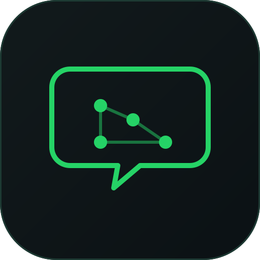

  

# Documentation

`matrix-whatsapp-mcp` is a single Go binary that runs a Matrix `/sync` listener
against a mautrix/whatsapp bridge and serves seven Model Context Protocol tools over
stdio or Streamable HTTP.

- [Tool reference](tools.md) — the seven tools, with every input, output, default, clamp, annotation and error.
- [Architecture](architecture.md) — packages, startup and shutdown, the sync pipeline, the ring buffer, the send gate, the bridge-ack guard, the allowlist file.
- [Operations](operations.md) — where to run it, a systemd unit, the environment file, logs and rotation, `doctor`, troubleshooting.
- [Development](development.md) — toolchain, the four gates, tests, the smoke script, CI, the `covdata` quirk.
- [Security](security.md) — token handling, the allowlist as the only send gate, rate limiting, the relay caveat, private disclosure.
- [Review record, November 2026](reviews/2026-11-review.md) — a point-in-time audit of the seven-tool surface with findings and gate output.
- [Project README](../README.md) — the front page, quick start and configuration table.

Start with the README if you are setting it up for the first time, and with
[tools.md](tools.md) if you are writing an MCP client against it.
