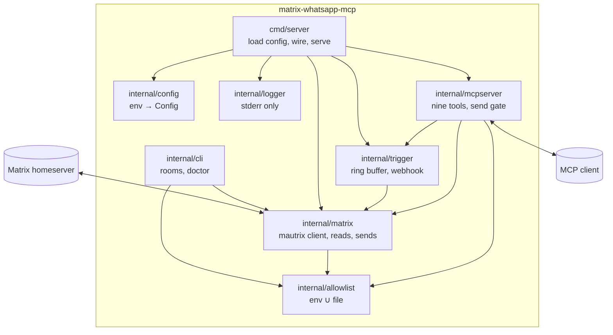

# Architecture

One process, one binary. It logs into Matrix as an account, runs a `/sync` loop,
keeps the most recent incoming messages in memory, and serves an MCP server over
stdio or Streamable HTTP on top of the same client.



## Packages

| Package | Responsibility |
| --- | --- |
| `cmd/server` | Entrypoint. No arguments: load config, build the client and dispatcher, serve MCP. Any argument: run a CLI subcommand and exit. |
| `internal/config` | Reads and validates the environment into `Config`. Errors name the variable and never its value. `ValidRoomID` is the one room-ID rule used everywhere. |
| `internal/logger` | The process-wide logger, writing to stderr. |
| `internal/matrix` | The mautrix wrapper: sync, room names, paginated reads, relations, search, message context, participants, media download and upload, sends, bridge-ack guard, E2EE setup. Exposed to everything above as the `MatrixService` interface. |
| `internal/allowlist` | The effective send allowlist: the `ALLOWED_SEND_ROOMS` baseline unioned with a plain-text file that is re-read as it changes. |
| `internal/trigger` | Turns `m.room.message` events into triggers, keeps the newest 100, and optionally POSTs them to a webhook. |
| `internal/mcpserver` | The MCP server: nine tool handlers, the send gate (allowlist plus rate limit), the idempotency cache, and the in-memory image handling `get_media` needs. |
| `internal/cli` | `rooms`, `rooms allow`/`rooms deny`, `doctor`. Every process edge is injectable, so the commands are tested without a homeserver or a terminal. |

The `MatrixService` interface is the seam: the MCP layer and the CLI are written
against it, so unit tests replace the homeserver with a mock and no test needs a
network.

## Startup

1. `config.Load` validates every variable and reports all problems at once. A
   failure exits non-zero before anything is created.
2. `matrix.New` performs **no network I/O**. It builds the mautrix client with a
   sync filter (timeline limit 50, lazy-loaded members), creates the page-token
   signer and the allowlist store, and registers the invite listener when auto-join
   is on. That the listener is registered here — before `DontProcessOldEvents` is
   installed on the first sync — is what makes an invitation that arrived while the
   bot was down still get accepted.
3. The dispatcher is created and attached to `m.room.message`.
4. A signal watcher turns the first SIGINT/SIGTERM into a context cancellation.
5. The sync loop starts in its own goroutine. Its first `init` does the network
   setup: `whoami` (and a fatal mismatch if the token belongs to another user), the
   crypto helper when E2EE is on, the `DontProcessOldEvents` filter so history never
   triggers handlers, and a background room-name seed.
6. The dispatcher's webhook workers start.
7. The MCP server is built around the client's own allowlist store, so the send gate
   and `SendText` can never disagree, and served over stdio or HTTP.

A `/sync` failure is classified: an invalid or missing token, or a token/user
mismatch, is fatal and stops the process non-zero so a supervisor can restart it
with a fixed configuration. Everything else is transient and retried with
exponential backoff from 1s to 1m plus jitter, reset after a minute of healthy
syncing.

## The sync pipeline

`Sync` blocks until its context is cancelled (returning nil) or a fatal error
occurs. Events flow from mautrix's syncer to two consumers:

- **Triggers.** Every `m.room.message` reaches the dispatcher, which records it and
  queues webhook delivery. Events sent by the bot's own account are filtered out
  before any handler sees them, so the server never reacts to its own messages.
- **Room names.** `m.room.name` state updates the name cache that `RoomName` serves
  without network I/O, which is what lets a trigger carry a room name on the sync
  path.

With `MATRIX_AUTO_JOIN_INVITES=true`, invitations are handled as a *sync listener*
rather than an event handler: invitation state arrives in `rooms.invite`, not in a
timeline. The inviter is read from the stripped invite state, checked against
`MATRIX_INVITE_ALLOWLIST` (case-insensitive; empty accepts anyone), and the join
runs off the sync goroutine with a 30-second timeout, an in-flight dedupe per room,
and a join by `Close`. A refusal is logged and leaves the invitation pending.

## The ring buffer and webhook

The dispatcher keeps the newest 100 triggers (`trigger.BufferSize`) in a
mutex-protected ring. `get_recent_triggers` reads from it newest first; a trigger
whose event ID is already in the buffer is not recorded twice.

Webhook delivery is separate from recording. When `TRIGGER_WEBHOOK_URL` is set, each
new trigger is queued (256 slots, four workers) and POSTed as JSON with a 5-second
timeout and exactly one retry after 500ms. Delivery is fully asynchronous and never
blocks the sync loop; a full queue drops the trigger with a log line rather than
stalling. Every worker exits on context cancellation and is joined by `Close`.
Transport errors are stripped of the URL, so a webhook URL carrying credentials in
its path or query cannot reach the log.

The buffer and the queue are process-local: a restart starts empty.

## Read paths

`Messages` walks `/messages` backward until it has the requested number of
convertible messages, the room is exhausted, or a bound is reached (10 pages and
`5 × limit` raw events). A busy room's timeline is mostly non-message events, so one
page alone would often return fewer messages than asked for.

The `before` cursor is not the homeserver's cursor. It is a signed token: the
cursor, a format version and the room it was issued for, HMAC-SHA256 with a random
per-process key, truncated to 16 bytes and encoded as base64url. Verification
happens before any request, so a malformed, edited, foreign or previous-process token
is an error instead of a homeserver round trip. The token holds no secret.

`search_messages` asks the homeserver's `/search` index first and degrades to a
bounded scan when the endpoint is missing; `get_message_context` uses `/context` and
falls back to walking `/messages` within a fixed budget. Both remember a missing
endpoint for the life of the process. Full bounds and error semantics are in
[tools.md](tools.md).

## Media

`get_media` is a read path with its own shape: it fetches one event, reads the
attachment descriptor from `content.url` or `content.file` plus `content.info`, and
downloads the payload into memory. Nothing is cached and nothing touches disk.

```
get_media
  → event_id validation (matrix.ValidEventID) before any request
  → GET /rooms/{roomId}/event/{eventId}
  → m.room.encrypted? decrypt with the crypto helper, or refuse when E2EE is off
  → attachment descriptor: mxc URI, mimetype, filename, size, w/h/duration
  → GET /_matrix/client/v1/media/download/{serverName}/{mediaId}, capped at 25 MiB
  → content.file? decrypt with the key and SHA-256 embedded in the event
  → images: decode, fit max_dimension (256..4096, default 1568), re-encode within
    about 1.5 MiB of base64 — JPEG quality 85..35, then 3/4 dimension steps to 64 px
  → text block with the metadata, plus an image or audio block when it fits
```

The caller gets one `text` block holding the metadata JSON and, when the payload
qualifies, a second content block with the bytes; an over-budget or non-renderable
payload returns the text block with a `reason` instead of a truncated file.
Decoding, scaling and re-encoding live in `internal/mcpserver` (with
`golang.org/x/image/draw` for Catmull-Rom scaling); the download, decryption and the
25 MiB cap live in `internal/matrix`.

`send_media` reuses the send path below, with the payload read from a file or base64
and uploaded first:

```
send_media
  → exactly one of path / data_base64, absolutism, readability, regular file, 50 MiB
  → idempotency claim keyed by SHA-256 of the payload (a replay uploads nothing)
  → send gate: effective allowlist, then the same one-token-per-3-seconds bucket
  → media encryption when the room is encrypted (content.file rather than content.url)
  → POST /_matrix/media/v3/upload
  → POST /rooms/{roomId}/send/m.room.message with m.image|m.video|m.audio|m.file
  → bridge-ack guard, then settle the idempotency key
```

## The send path

```
send_message
  → text / reply_to / idempotency_key validation
  → idempotency claim (replay or reservation)
  → send gate: effective allowlist, then one token per 3 seconds
  → matrix.SendText: room ID, allowlist again, text, reply ID
  → encryption check (refuse plaintext in an encrypted room when E2EE is off)
  → POST /rooms/{roomId}/send/m.room.message
  → bridge-ack guard: poll for the bridge's rejection notice
  → settle the idempotency key with the event ID
```

**The gate.** `sendGate` combines the live allowlist with a single-token bucket.
An empty allowlist rejects every send as read-only; a room outside a non-empty list
is rejected without spending the token; a throttled call returns
`rate limited, retry in Ns` rather than blocking. The allowlist is consulted per
send, which is why `rooms allow` takes effect without a restart. `SendText` checks
the same store again, so a caller that reaches it by another route is still gated.

**The bridge-ack guard.** Matrix accepting an event does not prove WhatsApp saw it.
A bridge that cannot forward a message posts an `m.notice` into the room that relates
to the sent event. After sending, `SendText` polls the room's 20 newest events every
100ms for up to `MATRIX_BRIDGE_ACK_TIMEOUT` and looks for a notice from another
account whose relation — flat `m.relates_to.event_id` or the reply form
`m.relates_to.m.in_reply_to.event_id` — points at the sent event. A match becomes a
`BridgeNoticeError`, which matches `matrix.ErrNotBridged`, carries the sent event ID
and the notice text flattened to one line, and fails the tool call. No match inside
the window means success. The guard starts no goroutine, honours the caller's
context, and issues no request at all when the timeout is `0`.

## The allowlist file

`allowlist.Store` is the single answer to "may this room receive a message": the
`ALLOWED_SEND_ROOMS` baseline unioned with the file, deduplicated, sorted. Both the
MCP send gate and the Matrix client hold the same instance.

The file is read at most once per second and only when the allowlist is consulted —
on the next send, or the next `rooms`/`doctor` run. There is no watcher goroutine,
so there is nothing to leak and no restart to forget. A re-read compares the bytes it
got with the bytes it has instead of trusting `mtime`, because timestamp resolution
varies by filesystem and a same-size rewrite inside one tick would otherwise go
unnoticed. An unreadable file keeps the last known list and logs the problem once; a
malformed line is a warning naming its line number and is otherwise skipped.

`Add` and `Remove` (behind `rooms allow` and `rooms deny`) rewrite the file through a
temporary file in the same directory plus a `rename`, after an `fsync`, with `0600`
on the file and `0700` on a directory they create. A concurrent reader sees either
the old file or the new one. Existing comments and ordering are kept. An empty
result is still read-only: the store offers no way to make the gate permissive.

## Encryption

With `MATRIX_E2EE_ENABLED=true`, the first sync initialises
`mautrix/crypto/cryptohelper` with a SQLite store at `MATRIX_CRYPTO_DB_PATH` and the
key from `MATRIX_PICKLE_KEY`. `SendText` then encrypts for the room. With E2EE off,
an encrypted room is refused at send time rather than receiving plaintext. An
encrypted event that cannot be decrypted is returned with `encrypted: true` and a
fixed placeholder body, never ciphertext.

The crypto store is state: back it up or lose the ability to decrypt that session,
and keep it out of version control (`.gitignore` covers `*.db`, `*.db-wal` and
`*.db-shm`).

## Shutdown

On SIGINT/SIGTERM, or a fatal sync error, the run context is cancelled. The serve
loop returns, then the dispatcher is closed (workers cancelled and joined), then the
Matrix client is closed (background context cancelled, the sync stopped, background
goroutines waited for, the crypto store closed), then every remaining goroutine is
joined before the process exits. A graceful shutdown exits `0`; a fatal start or
sync error exits non-zero. Logging goes to stderr only, so in stdio mode nothing but
MCP frames ever reaches stdout.

## HTTP transport

`MCP_TRANSPORT=http` serves the Streamable HTTP handler on `HTTP_ADDR` behind an
`http.Server` with a 5-second read-header timeout, a 30-second read timeout and a
120-second idle timeout. `WriteTimeout` is deliberately 0: the transport holds a
long-lived GET SSE stream open for server-to-client messages, and a server-wide
write deadline would cut it. Shutdown is graceful with a 10-second bound.

## Network bounds

Every call an agent can make is bounded, so one casual tool call cannot become an
unbounded fan-out.

| Path | Bound |
| --- | --- |
| `list_rooms` probes | 8 concurrent, 10-second phase deadline; unfinished rooms are listed unprobed |
| `read_messages` | 10 `/messages` pages, `5 × limit` raw events |
| `search_messages` scan | 10 rooms, 50 messages per room |
| `get_message_context` fallback | 5 pages × 100 raw events |
| `list_participants` | 10-second call, 8 concurrent profile lookups of 2 seconds each |
| `send_message`, `send_media` | one send per 3 seconds, shared between them; bridge-ack poll bounded by `MATRIX_BRIDGE_ACK_TIMEOUT` |
| `get_media` | 25 MiB download cap; images downscaled to `max_dimension` and re-encoded within about 1.5 MiB of base64 |
| `send_media` | 50 MiB upload cap |
| `Sync` | 30-second auto-join; backoff capped at 1 minute |
| CLI commands | 30-second command budget, 20-second bridged-probe phase |
| HTTP server | 5s read-header, 30s read, 120s idle, 10s graceful shutdown |
